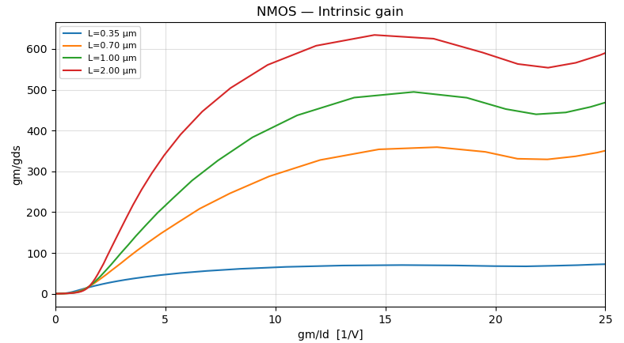
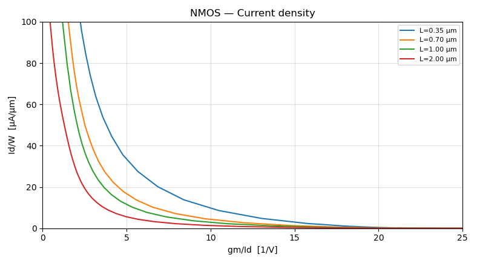

# gm/Id Sizing Toolkit

Size CMOS analog transistors from simulated device data instead of square-law hand calculations.

This tool characterizes a process's NMOS and PMOS devices in LTspice across a four-dimensional bias space (L, V<sub>GS</sub>, V<sub>DS</sub>, V<sub>SB</sub>), stores the results as lookup tables, and turns a design target such as *"g<sub>m</sub>/I<sub>D</sub> = 12 at L = 1 µm, I<sub>D</sub> = 50 µA"* into a bias voltage and transistor width in one command.

📄 **Paper:** [A gm/Id Methodology Design Tool for Analog CMOS Circuit Synthesis: Application to the Folded-Cascode Class-AB Amplifier](report/main.pdf) (IEEE conference format, 4 pages)

<p align="center">
  
  
</p>
<p align="center"><em>Design curves generated from the NMOS lookup table: intrinsic gain g<sub>m</sub>/g<sub>ds</sub> (left) and current density I<sub>D</sub>/W (right) vs. g<sub>m</sub>/I<sub>D</sub>, one curve per channel length.</em></p>

---

## Why gm/Id?

Square-law equations stop being accurate in short-channel devices and in moderate inversion. Hand sizing turns into a loop of calculating a width, simulating it, adjusting, and simulating again. The gm/Id method replaces that loop with simulated data. You choose an inversion level (g<sub>m</sub>/I<sub>D</sub>) based on what the circuit needs, such as gain, speed, or headroom, and then read the current density, intrinsic gain, f<sub>T</sub>, and V<sub>dsat</sub> straight from the device's characterized behavior. Width is just I<sub>D</sub> divided by the current density.

This repo automates the whole flow, from the SPICE sweep to the sized device.

## Workflow

```
 nmos_char.asc ──► characterization.py ──► nmos_lut.npz / pmos_lut.npz
  (testbench)       (LTspice .op sweep)           │
                                                  ├──► view_lut.py   design curves
                                                  └──► query_lut.py  bias point / sizing
```

### 1. Characterize the process

```bash
python src/characterization.py
```

This runs one LTspice `.op` simulation per bias point on a testbench with both an NMOS and a PMOS in it. The PMOS terminals are mirrored to VDD inside the netlist, so each simulation characterizes both devices. Simulations run in parallel through PyLTSpice. The output is two 4D lookup tables indexed by `[L, Vgs, Vds, Vsb]`, holding:

| Field | Meaning |
|---|---|
| `Id`, `gm`, `gds`, `gmb`, `cgg` | Raw operating-point values at reference width W = 10 µm |
| `vth`, `vdsat` | Threshold and saturation voltage |
| `gm_id` | Transconductance efficiency (inversion level) |
| `id_w` | Current density, used to compute width |
| `gm_gds` | Intrinsic gain |
| `ft` | Transit frequency, g<sub>m</sub> / (2π·C<sub>gg</sub>) |

Sweep ranges and resolution are set at the top of `characterization.py`. `FAST = 1` gives a coarse grid for quick iteration, and `FAST = 0` gives the full-resolution sweep.

### 2. View the design curves

```bash
python src/view_lut.py                                   # NMOS, Vds = 0.9 V, Vsb = 0
python src/view_lut.py --path char_data/pmos_lut.npz
python src/view_lut.py --l 0.3 1.0 2.0 --vds 0.6         # chosen lengths, different Vds slice
```

This plots current density, intrinsic gain, and f<sub>T</sub> against g<sub>m</sub>/I<sub>D</sub>, as well as g<sub>m</sub>r<sub>o</sub> vs. V<sub>DS</sub> and V<sub>dsat</sub> vs. g<sub>m</sub>/I<sub>D</sub>, with one curve per channel length. Run `--help` for the full set of options.

### 3. Size a transistor

**Design mode:** give a g<sub>m</sub>/I<sub>D</sub> target and get the bias point and width.

```bash
python src/query_lut.py --l 1.0 --gmid 15 --vds 0.9 --id 50e-6   # size for Id = 50 µA
python src/query_lut.py --l 1.0 --gmid 15 --vds 0.9 --gm 500e-6  # size for gm = 500 µS
```

This solves for the V<sub>GS</sub> that hits the target g<sub>m</sub>/I<sub>D</sub> (by interpolating the LUT and root-finding), reports the full operating point, and scales W to meet the required I<sub>D</sub> or g<sub>m</sub>.

**Bias mode:** give a bias point and see what the device looks like there.

```bash
python src/query_lut.py --l 1.0 --vgs 1.0 --vds 0.9 --vsb 0.45
```

Running `query_lut.py` with no arguments starts an interactive prompt.

## Try it without LTspice

Characterized lookup tables are included in [`char_data/`](char_data/), so `view_lut.py` and `query_lut.py` work right after installing the Python dependencies. You only need LTspice to re-characterize or to use a different process model. The included tables use the coarse (`FAST = 1`) grid, so regenerate with `FAST = 0` for final sizing.

## Example: folded-cascode class-AB op-amp

The [paper](report/main.pdf) uses the toolkit to size a folded-cascode amplifier with a class-AB output stage driving a 100 Ω load. One example from it: choosing the inversion level for the NMOS output device, which has to supply about 14.6 mA peak.

| g<sub>m</sub>/I<sub>D</sub> (V⁻¹) | I<sub>D</sub>/W (µA/µm) | g<sub>m</sub>/g<sub>ds</sub> | Total W (µm) |
|---|---|---|---|
| 10 | 1.12 | 22.6 | 13,469 |
| 7 | 18.3 | 13.0 | 785 |
| 5 | 28.3 | 7.4 | 529 |

Moving to stronger inversion shrinks the device by more than 25× at the cost of intrinsic gain. The table makes that trade-off visible in a few queries instead of several simulate-and-adjust iterations.

## Repository layout

```
src/
  characterization.py   4D NMOS/PMOS sweep → char_data/*.npz
  view_lut.py           design-curve plots
  query_lut.py          bias-mode / design-mode queries and sizing
  spice.py              PyLTSpice wrapper: netlist editing, parallel sim runs
  callbacks.py          collects .raw/.log output from each sim
  parser.py             extracts traces, .meas results, and device OP data into dataclasses
  helpers.py            stats printing and plotting utilities
  runconfig.py          LTspice path and parsing options
simulations/            characterization testbench, process model, example circuits
char_data/              pre-generated NMOS and PMOS lookup tables
report/                 paper source (LaTeX), figures, and PDF
```

The LTspice layer (`spice.py`, `callbacks.py`, `parser.py`) is general-purpose. You can point it at any schematic to run parameter sweeps and pull out traces, `.meas` values, and transistor operating points.

## Requirements

- Python 3.10+
- `pip install numpy scipy matplotlib PyLTSpice`
- [LTspice](https://www.analog.com/en/resources/design-tools-and-calculators/ltspice-simulator.html), only needed for characterization. Set the executable path in `src/runconfig.py`; the default is the standard Windows install location.

## Next steps

- Process corners and Monte Carlo characterization
- Export lookup tables to CSV or Pandas
- Automatically size a full circuit from a list of per-device specs

## References

- F. Silveira, D. Flandre, and P. G. A. Jespers, "A gm/Id based methodology for the design of CMOS analog circuits and its application to the synthesis of a silicon-on-insulator micropower OTA," *IEEE JSSC*, vol. 31, no. 9, pp. 1314–1319, 1996. [doi:10.1109/4.535414](https://doi.org/10.1109/4.535414)
- B. Murmann, "CMOS Transistor Sizing: Gm/Id Approach," Circuit Insights (ISSCC 2026), Episode 5. [YouTube](https://www.youtube.com/watch?v=oNDmJ2a3tWI)
- [PyLTSpice](https://github.com/nunobrum/PyLTSpice): Python interface for LTspice
